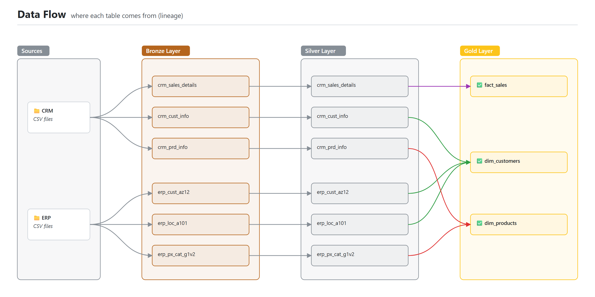
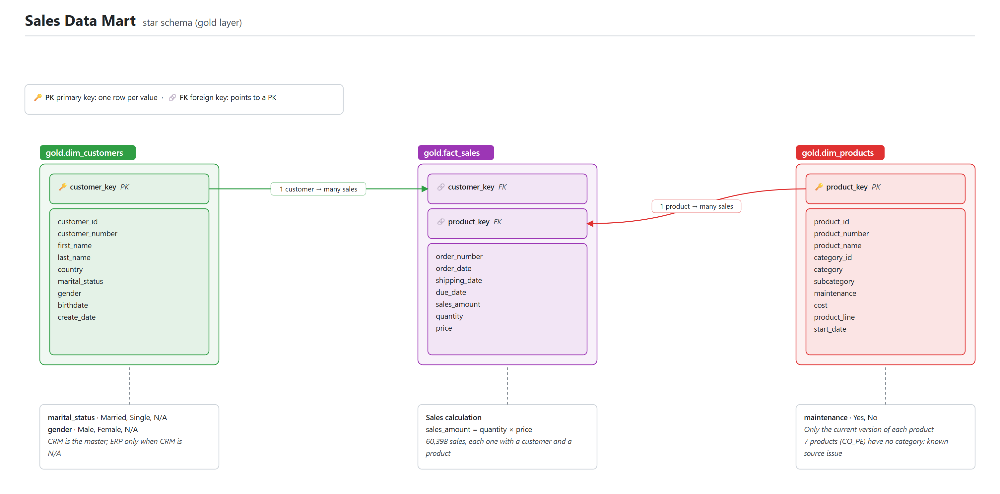
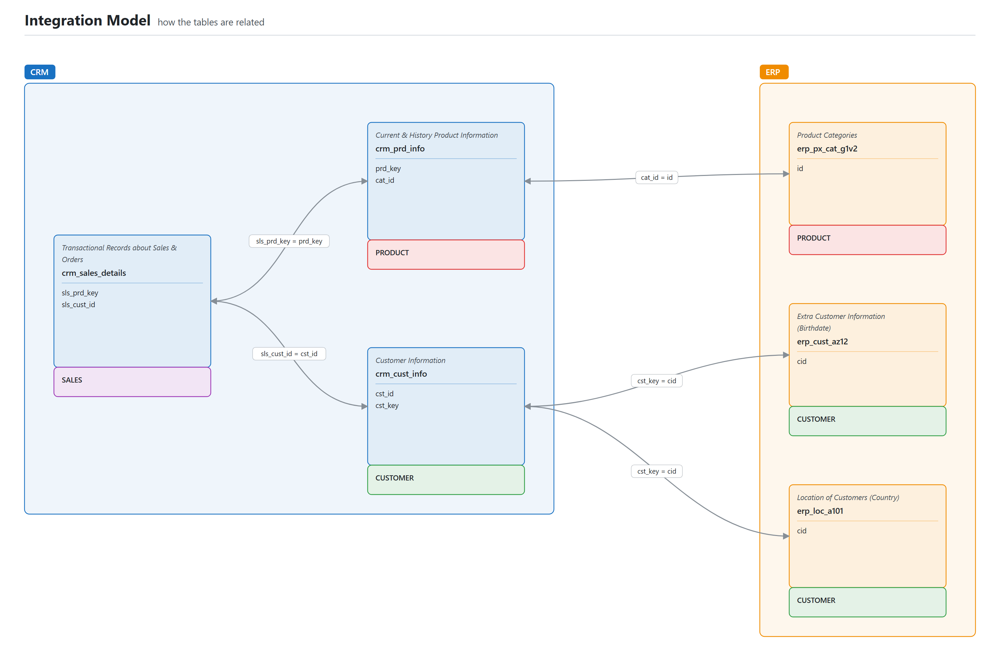

# Southline Cycles Data Warehouse

A SQL Server data warehouse that takes sales data from two source systems (a CRM and an ERP, delivered as CSV files), cleans it, and turns it into a star schema ready for reporting.

| | |
|---|---|
| **Built with** | SQL Server Express, T-SQL, SQL Server Management Studio, Git |
| **Input** | 6 CSV files from 2 systems, about 116,000 rows |
| **Output** | 3 views: 18,484 customers, 295 products, 60,398 sales lines (27,659 orders) |
| **What it covers** | Layered architecture, bulk loading, data cleaning, stored procedures with error handling, data modeling, quality checks, documentation |

I built this project step by step in SQL Server, following the course [SQL Data Warehouse from Scratch](https://www.youtube.com/watch?v=9GVqKuTVANE) by Data with Baraa. The dataset and the design come from the course. The section on [source data problems](#problems-found-in-the-source-data) records what the cleaning found, including two problems I recorded instead of fixing.

## How it is built

The warehouse has three layers. Each one does a single job:

| Layer | Job | Objects | How it is loaded |
|---|---|---|---|
| **Bronze** | Keep the source data exactly as it arrived | 6 tables | `EXEC bronze.load_bronze` (truncate and bulk insert from the CSV files) |
| **Silver** | Clean and standardize | 6 tables | `EXEC silver.load_silver` (truncate and insert from bronze) |
| **Gold** | Business-ready data for reports | 3 views | Nothing to load: the views read from silver |

Keeping the raw data untouched in bronze means a cleaning rule can be changed and rerun at any time without going back to the source. Both procedures do a full load, so running them twice gives the same result.



More detail on what each layer does and does not do: [docs/data_architecture.md](docs/data_architecture.md).

## The data model

The gold layer is a star schema: one fact (sales) and two dimensions (customers and products).



Every column is described in the [data catalog](docs/data_catalog.md).

The two source systems describe the same customers and products with different keys. This is how the six source tables connect, and which business object each one belongs to:



## What it answers

With the gold layer, a business question is one short query. Sales by product category:

```sql
SELECT
    p.category,
    COUNT(DISTINCT f.order_number) AS orders,
    SUM(f.quantity)                AS units,
    SUM(f.sales_amount)            AS total_sales
FROM gold.fact_sales AS f
LEFT JOIN gold.dim_products AS p
    ON p.product_key = f.product_key
GROUP BY p.category
ORDER BY total_sales DESC;
```

| category | orders | units | total_sales |
|---|---:|---:|---:|
| Bikes | 15,205 | 15,205 | 28,316,272 |
| Accessories | 18,208 | 36,112 | 700,262 |
| Clothing | 7,461 | 9,106 | 339,716 |

Bikes are 96% of the 29.4 million in sales, even though more orders include an accessory than a bike.

## Problems found in the source data

Most of the work in this project was finding out what was wrong with the data and deciding what to do about it. The counts were measured on the loaded data.

| Problem | Where | Size | What the warehouse does |
|---|---|---|---|
| Customers with no id | CRM customers | 3 rows | Dropped |
| Same customer id in more than one row | CRM customers | 5 ids (11 rows) | Keeps the most recent record |
| Extra spaces around names | CRM customers | 26 rows | Trimmed |
| No gender in the CRM | CRM customers | 4,569 customers | Uses the ERP gender when it has one (4,554 filled; 15 stay `N/A`) |
| CRM and ERP disagree on gender | CRM and ERP customers | 57 customers | The CRM value wins |
| Customer ids with a `NAS` prefix | ERP customers | 11,042 of 18,483 rows | Prefix removed so the ids match the CRM |
| Customer ids with a hyphen | ERP locations | all 18,484 rows | Hyphen removed so the ids match the CRM |
| Birthdates in the future | ERP customers | 16 rows | Set to empty |
| Gender and country written in several ways (`F`, `Female`, `US`, `USA`, blank...) | ERP customers and locations | 6 and 11 variations | One readable value each; blanks become `N/A` |
| End date earlier than start date | CRM products | 200 of 397 rows | End date rebuilt as the day before the next version starts |
| Missing cost | CRM products | 2 rows | Set to 0 |
| Invalid order date | CRM sales | 19 rows | Set to empty |
| Sales amount or price missing, zero, negative, or not matching quantity × price | CRM sales | 35 rows | Recalculated so that sales = quantity × price |

Two problems were **recorded and left as they are**, because fixing them needs an answer from whoever owns the source:

- **Category code `CO_PE` does not exist in the ERP.** Seven pedal products in the CRM use `CO_PE`. The ERP category list has `CO_PD` (Components / Pedals) and no product uses it. They are probably the same category typed two ways, but I could not confirm which code is right, so the seven products have no category in `gold.dim_products`. None of them has sales yet, so no report is affected today. Recommendation: confirm the code with the ERP owner and correct it in the source.
- **The last line of two CSV files is not loaded.** `cust_info.csv` and `CUST_AZ12.csv` do not end with a line break and their last line ends in an empty field, so `BULK INSERT` skips it. In `cust_info.csv` the line is junk (it has no customer id). In `CUST_AZ12.csv` it is a real customer, `AW00029483`, who therefore has no birthdate in the warehouse. Recommendation: have the source system end its files with a line break.

## Repository

```
datasets/                          the six source CSV files, unchanged
    source_crm/
    source_erp/
docs/
    data_architecture.md           the three layers
    naming_conventions.md          how tables, columns and scripts are named
    data_catalog.md                every column of the gold views
    data_flow.png                  where each table comes from
    data_integration.png           how the source tables are related
    data_model.png                 the star schema
scripts/
    init_database.sql              creates the database and the three schemas
    bronze/
        ddl_bronze.sql             creates the bronze tables
        proc_load_bronze.sql       creates bronze.load_bronze
    silver/
        ddl_silver.sql             creates the silver tables
        proc_load_silver.sql       creates silver.load_silver
    gold/
        ddl_gold.sql               creates the three gold views
tests/
    quality_checks_silver.sql      checks used to find the problems and confirm the fixes
    quality_checks_gold.sql        checks for the keys and the links of the star schema
```

## Running it

You need SQL Server (the free Express edition is enough) and SQL Server Management Studio. Run the scripts in this order:

1. `scripts/init_database.sql`. It drops the `DataWarehouse` database if it already exists.
2. `scripts/bronze/ddl_bronze.sql`.
3. `scripts/bronze/proc_load_bronze.sql`. Before running it, change the folder in the six `FROM` lines to where you saved this repository. Then run `EXEC bronze.load_bronze;`.
4. `scripts/silver/ddl_silver.sql` and `scripts/silver/proc_load_silver.sql`. Then run `EXEC silver.load_silver;`.
5. `scripts/gold/ddl_gold.sql`.

To check the result, run the two files in `tests/`. Each check says what it expects. A quick one: `SELECT COUNT(*) FROM gold.fact_sales;` returns 60,398.

These steps were tested from an empty database, and the result matched the working database row by row.

## License

[MIT](LICENSE). The dataset comes from the course by Data with Baraa, also under the MIT License ([details](datasets/README.md)).
